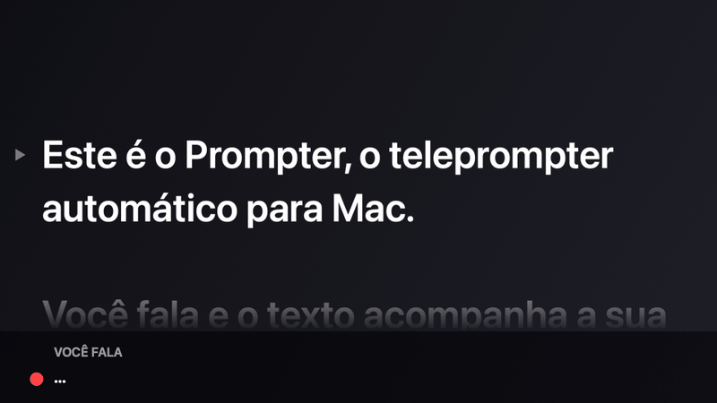
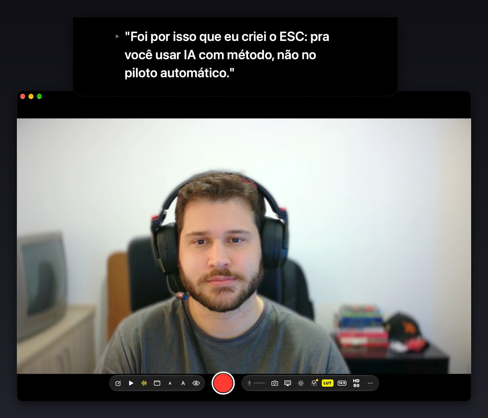
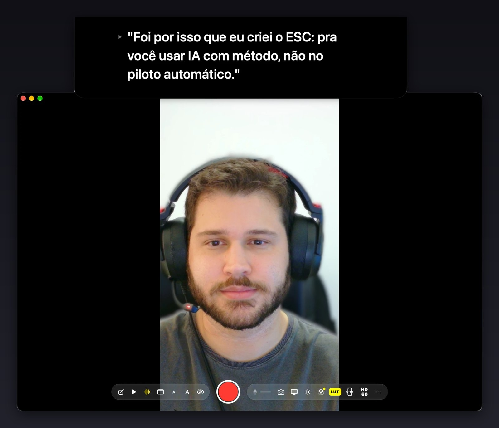
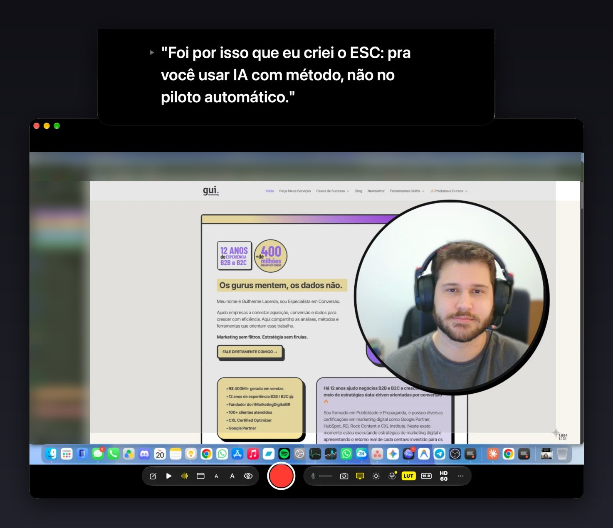

# Prompter: teleprompter grátis e automático para macOS

<p align="center">
  
</p>

<p align="center"><em>Teleprompter automático: você fala e o texto acompanha. Se improvisar, ele espera; quando você volta ao roteiro, ele se localiza.</em></p>

<p align="center">
  <a href="https://github.com/guilhermemarketing/prompter/stargazers"></a>
  
  
  
  <a href="LICENSE"></a>
  
</p>

**Prompter é um teleprompter grátis para macOS que rola sozinho conforme você fala e grava câmera, tela e microfone no mesmo app.** Dá para gravar Reels, vídeos para o YouTube, videoaulas e tutoriais direto do Mac, lendo o roteiro sem desviar o olhar da câmera. Quando não precisar de roteiro, oculte o teleprompter e use o app só para gravar. É open-source (MIT), sem assinatura, sem compras dentro do app e sem marca d'água. Feito em Swift para Mac com Apple Silicon (M1, M2, M3, M4 e posteriores), com todo o processamento no próprio computador.

Criado por **[Gui · gui.marketing](https://gui.marketing)**.

<p align="center">
  <a href="https://github.com/guilhermemarketing/prompter/stargazers"></a>
  <br>
  <sub>Se o Prompter te ajudou, deixe uma ⭐: isso ajuda outras pessoas a encontrar este teleprompter grátis.</sub>
</p>

*English below: [free teleprompter for Mac](#english).*

## Teleprompter automático: o texto segue a sua voz

O modo voz é o coração do Prompter. Em vez de rolar numa velocidade fixa que você precisa acompanhar, o teleprompter automático ouve a sua fala e avança o texto no seu ritmo:

- **Palavra por palavra:** o que você já falou fica apagado e a linha seguinte sobe sozinha até a altura da câmera.
- **Improviso sem perder o lugar:** se você sai do roteiro, o texto espera. Quando você volta, ele encontra o trecho e continua.
- **Trechos pulados:** se você pula uma frase ou um parágrafo, ele se reencontra mais adiante.
- **Sem controle remoto, pedal ou ajuste de velocidade:** você só fala. Se quiser reposicionar, role no trackpad.
- **No próprio Mac:** o reconhecimento de voz roda on-device, em português, inglês, espanhol, francês, italiano ou alemão, conforme o idioma do roteiro.

## Interface

<p align="center">
  
  <br><sub>Teleprompter fixo no topo da tela, junto da câmera, gravando em 16:9.</sub>
</p>

<table>
  <tr>
    <td width="50%"><br><sub>Reels, TikTok e Shorts em 9:16.</sub></td>
    <td width="50%"><br><sub>Videoaula: tela com a câmera em destaque.</sub></td>
  </tr>
</table>

## Por que usar o Prompter como teleprompter no Mac

- **100% gratuito de verdade:** nenhum recurso fica atrás de pagamento. Código aberto no GitHub.
- **Segue a sua fala:** o texto rola sozinho enquanto você fala, como um karaokê. Você não precisa ajustar a velocidade nem usar pedal ou controle remoto.
- **Teleprompter e gravador juntos:** grava a câmera, a tela ou as duas, com áudio sincronizado. Você não precisa de OBS nem de outro gravador.
- **Texto perto da câmera:** o roteiro pode ficar fixo no topo da tela, junto da câmera do MacBook ou do iMac, para o seu olhar continuar na lente.
- **Privado:** transcrição, recorte de fundo e sincronia rodam no Mac. Nenhum roteiro ou vídeo é enviado para a internet.
- **Português e inglês:** a interface segue o idioma do Mac: português quando o sistema está em português e inglês nos demais idiomas.

## Recursos do teleprompter

- **Modo voz (karaokê):** transcrição de fala on-device. As palavras já ditas ficam apagadas e a próxima linha sobe sozinha. Tolera improvisos e trechos pulados. O idioma (português, inglês e outros) é detectado pelo roteiro.
- **Modo tempo:** rolagem em velocidade constante, ajustável pelo teclado.
- **Três posições do texto:**
  - sobre a prévia da câmera;
  - em caixa solta sempre à frente das outras janelas;
  - fixo no topo da tela, junto da câmera.
- **Tamanho da fonte e atalhos de teclado** para controlar tudo sem tirar os olhos do texto.
- **Teleprompter opcional:** oculte o texto com H quando quiser só gravar, por exemplo uma videoaula, e mostre de novo quando precisar.

## Gravar Reels no Mac com teleprompter

Escolha o formato 9:16 e grave Reels, TikTok e Shorts direto do Mac, já recortados na vertical, em até 4K. O roteiro fica junto da câmera e rola sozinho enquanto você fala, então o vídeo sai com você olhando para a lente, sem decorar o texto e sem celular. Os formatos 4:5 (feed) e 16:9 (YouTube) funcionam do mesmo jeito.

## Gravar videoaula no Mac

Para videoaulas, cursos online e tutoriais, use o modo Tela: grave a tela inteira, uma janela ou uma área, com a sua câmera em destaque sobre o conteúdo. Leia o roteiro no teleprompter ou, se preferir falar livremente, oculte o teleprompter (tecla H) e use o Prompter só como gravador de tela e câmera. Para aulas longas, gravar só a composição deixa o Mac mais leve.

## Gravação de vídeo com teleprompter

- **Câmera:** formatos 16:9 (YouTube), 9:16 (Reels, TikTok, Shorts) e 4:5 (feed), com o recorte já na prévia. Resolução HD, 2K ou 4K, a 24, 30 ou 60 fps, conforme a câmera.
- **Gravação de tela com câmera:**
  - tela inteira, janela ou área desenhada;
  - câmera em destaque em círculo, quadrado ou retângulo, que você arrasta e redimensiona na prévia;
  - você escolhe os arquivos: composição, só a tela e/ou só a câmera, todos sincronizados.
- **Imagem:**
  - luz automática guiada pelo rosto;
  - ajustes de contraste, brilho, pretos, sombras, brancos, nitidez e matiz, com presets;
  - LUTs `.cube` (5 incluídas) com controle de intensidade;
  - fundo chroma key (verde, azul ou vermelho) e estilos cel-shading e adesivo.
- **Qualidade:** Econômica, Recomendada, Superior HEVC, Superior ProRes 422 HQ ou taxa personalizada até 250 Mbps.
- **Áudio:**
  - microfone mono gravado nos dois canais;
  - correção automática da sincronia labial depois de cada gravação, sem recodificar;
  - fila de áudio sem descartes.
- **Cor fiel:** os arquivos saem marcados como sRGB e ficam iguais à prévia.

## Baixar o teleprompter grátis para Mac

<p align="center"><a href="https://github.com/guilhermemarketing/prompter/releases/latest/download/Prompter.zip"><strong>⬇ Baixar o Prompter para macOS (grátis)</strong></a></p>

Requisitos: Mac com Apple Silicon (M1 ou posterior) e macOS 26 ou posterior.

## Como instalar

1. Baixe o [Prompter.zip](https://github.com/guilhermemarketing/prompter/releases/latest/download/Prompter.zip) e abra o arquivo para descompactar.
2. Arraste o **Prompter** para a pasta **Aplicativos**.
3. Abra o app. Como ele não é distribuído pela App Store, o macOS avisa que não pode verificar o desenvolvedor na primeira vez. Clique em **OK**.
4. Vá em **Ajustes do Sistema → Privacidade e Segurança**, role até o aviso sobre o Prompter e clique em **Abrir Mesmo Assim**. Isso só é preciso uma vez.
5. Permita câmera e microfone. Para gravar a tela, permita também Gravação de Tela.

Se preferir o Terminal, este comando libera o app no lugar dos passos 3 e 4:

```bash
xattr -dr com.apple.quarantine /Applications/Prompter.app
```

Todas as versões e notas de mudança ficam em [Releases](https://github.com/guilhermemarketing/prompter/releases).

## Compilar a partir do código-fonte

Precisa das Command Line Tools do Xcode (`xcode-select --install`). O Xcode completo não é necessário.

```bash
git clone https://github.com/guilhermemarketing/prompter.git
cd prompter
./build.sh --install
```

O comando compila o app e copia o **Prompter** para `/Applications`. Sem `--install`, o app fica em `dist/Prompter.app`.

Variáveis opcionais:

- `PROMPTER_SCRATCH`: pasta de build (padrão: `$TMPDIR/prompter-build`).
- `PROMPTER_SIGNING_IDENTITY`: certificado de assinatura (padrão: `Prompter Local Signing`).

### Assinatura estável (recomendado)

Com assinatura ad-hoc, o macOS pede de novo câmera, microfone e Gravação de Tela a cada build. Para evitar isso, crie uma vez um certificado de assinatura local no seu Chaves:

```bash
cat > /tmp/prompter-cert.cnf <<'EOF'
[ req ]
distinguished_name = dn
prompt = no
x509_extensions = ext
[ dn ]
CN = Prompter Local Signing
[ ext ]
basicConstraints = critical, CA:false
keyUsage = critical, digitalSignature
extendedKeyUsage = critical, codeSigning
EOF
openssl req -x509 -newkey rsa:2048 -nodes -keyout /tmp/k.pem -out /tmp/c.pem -days 3650 -config /tmp/prompter-cert.cnf
openssl pkcs12 -export -inkey /tmp/k.pem -in /tmp/c.pem -name "Prompter Local Signing" -out /tmp/id.p12 -passout pass:temp
security import /tmp/id.p12 -k ~/Library/Keychains/login.keychain-db -P temp -T /usr/bin/codesign
rm -P /tmp/k.pem /tmp/id.p12 /tmp/c.pem /tmp/prompter-cert.cnf
```

## Permissões e privacidade

O app pede acesso à câmera e ao microfone. Para gravar a tela, pede também Gravação de Tela e Áudio do Sistema. Nada sai do Mac: transcrição, segmentação de pessoa e análise de sincronia rodam localmente. Na primeira vez em que o modo voz é usado num idioma, o macOS baixa o modelo de voz da Apple.

Os vídeos ficam em `~/Movies/Prompter/`.

## Atalhos de teclado

| Ação | Atalho |
|---|---|
| Ouvir / rolar / pausar | Espaço |
| Modo voz ↔ tempo | V (⇧⌘V) |
| Velocidade (modo tempo) | ↑ ↓ |
| Voltar / avançar um trecho | ← → (ou trackpad) |
| Voltar ao início | ⌘↑ ou Home |
| Texto maior / menor | ⌘= / ⌘− |
| Alternar formato | F |
| Luz automática | L (⇧⌘L) |
| Posição do teleprompter | T |
| Ocultar / mostrar teleprompter | H (⇧⌘H) |
| Gravar / parar | R (⌘R) |
| Editar roteiro | E (⌘E; Esc fecha) |
| Pasta de gravações | ⇧⌘O |

## Perguntas frequentes

### O que é um teleprompter?

Teleprompter é um aparelho ou programa que exibe o roteiro perto da câmera e o rola enquanto você lê. Use-o para gravar vídeos, aulas e apresentações olhando para a lente, sem decorar nada. No Mac, o Prompter mostra o roteiro logo abaixo da webcam.

### O que é um teleprompter automático?

Teleprompter automático rola o texto sozinho, acompanhando a sua voz, sem velocidade fixa nem operador. No Prompter, o reconhecimento de fala localiza a palavra que você diz e sobe a linha até a câmera. Improvise ou pause à vontade: ele espera e retoma.

### Qual o melhor teleprompter para Mac?

O melhor teleprompter para Mac rola pela sua voz, mantém o texto junto da câmera e grava o vídeo no mesmo app. O Prompter reúne tudo isso de graça, com gravação em até 4K, Reels em 9:16 e processamento no próprio Mac. Instale e compare.

### Existe teleprompter grátis para Mac?

Sim. O Prompter é um teleprompter grátis para Mac, open-source, sem assinatura, compras no app ou marca d'água. Muitos apps gratuitos cobram para liberar recursos; no Prompter, rolagem pela voz, gravação em 4K e gravação de tela já vêm inclusas. Instale e use sem limite.

### Como gravar Reels no Mac?

Para gravar Reels no Mac, abra o Prompter, escolha o formato 9:16 e cole o roteiro com a tecla E. Ative o modo voz com V e grave com R. O vídeo sai vertical, em até 4K, pronto para Instagram, TikTok e YouTube Shorts.

### Como usar teleprompter no Mac?

Instale o Prompter, permita câmera e microfone e cole o roteiro com a tecla E. Deixe o texto junto da câmera com T, ative o modo voz com V e grave com R. Fale naturalmente: o texto acompanha você e o vídeo vai para Filmes.

### Como gravar videoaula no Mac?

Para gravar videoaula no Mac, abra o Prompter, ative o modo Tela e escolha a tela, uma janela ou uma área. Sua câmera aparece em destaque sobre a aula. Use o roteiro no teleprompter ou oculte-o com H e grave com R.

### Dá para usar o Prompter sem teleprompter?

Sim. Pressione H ou clique no ícone de olho para ocultar o teleprompter, e o Prompter vira só um gravador de câmera e tela. É o jeito mais simples de gravar videoaulas, tutoriais e cursos online sem roteiro, com áudio sincronizado e até 4K.

### O teleprompter precisa de internet?

Não. O reconhecimento de voz do Prompter roda no próprio Mac, e o roteiro, a voz e os vídeos nunca saem do computador. A internet só é usada uma vez, quando o macOS baixa o modelo de voz da Apple para o idioma do roteiro.

### O Prompter funciona em MacBook e iMac?

Sim. O Prompter funciona em MacBook, iMac, Mac mini e Mac Studio com Apple Silicon e macOS 26 ou posterior. Use a câmera embutida ou uma webcam USB e o microfone do Mac ou um externo. Deixe o texto fixo junto da câmera embutida.

### Dá para gravar a tela e a câmera ao mesmo tempo?

Sim. Escolha o modo Tela e grave a tela inteira, uma janela ou uma área, com a sua câmera em destaque em círculo, quadrado ou retângulo. Arraste o destaque pela prévia e, para editar depois, salve também a tela e a câmera em arquivos separados.

## Arquitetura

- **`CaptureEngine`:** câmera, microfone e captura de tela.
- **`FrameProcessor`:** luz, cor, LUT, máscara de pessoa e chroma, recorte e escala na GPU, com renderização assíncrona.
- **`ScreenCompositor`:** tela mais câmera em destaque.
- **`MovieWriter`:** AVAssetWriter com fila de áudio e preenchimento de lacunas.
- **`SpeechFollower` + `ScriptAligner`:** voz → posição no roteiro.
- **`PrompterLayout` + `PrompterTextView`:** TextKit, karaokê e rolagem a 120 Hz.
- **`LipSync`:** medição e correção da sincronia labial.
- **`DemoRenderer`:** gera a animação deste README com o mesmo código do app (`--demo-render ROTEIRO VOZ PASTA`).

`@ViewState` é um alias de `SwiftUI.State` para compilar sem o plugin de macros, que só acompanha o Xcode.

## Histórico de estrelas

<a href="https://star-history.com/#guilhermemarketing/prompter&Date">
  
</a>

## Licença e autoria

MIT. Veja [LICENSE](LICENSE).

Prompter foi criado por [Gui, do gui.marketing](https://gui.marketing).

---

## English

**Prompter is a free, open-source automatic teleprompter for Mac: it follows your voice and records your camera, screen and microphone.** You can record Reels, YouTube videos, video lessons and tutorials straight from your Mac, or hide the teleprompter and use it as a plain camera and screen recorder. There is no subscription, no in-app purchase and no watermark. It is native Swift for Apple Silicon Macs running macOS 26 or later, and everything runs on-device.

- **Automatic, voice-follow teleprompter:** on-device speech recognition scrolls the script as you read, karaoke-style. If you improvise, it waits; when you return to the script, it finds its place. A constant-speed mode is also available.
- **Flexible placement:** the text can sit over the camera preview, float above other apps, or stay pinned at the top of the screen next to the camera.
- **Camera recording:** 16:9, 9:16 and 4:5 crops with live preview, up to 4K at 60 fps.
- **Screen recording with camera:** record a display, a window or a selected area, with a draggable camera bubble. Composite, screen-only and camera-only files stay in sync.
- **Look:**
  - face-aware auto exposure;
  - color adjustments with presets;
  - `.cube` LUTs (five included);
  - chroma-key backgrounds and cel-shading or sticker styles.
- **Quality and audio:**
  - HEVC or ProRes 422 HQ;
  - dual-mono microphone;
  - automatic lip-sync correction after each recording;
  - drop-free audio pipeline.

### Frequently asked questions

#### What is an automatic teleprompter?

An automatic teleprompter scrolls the script by itself, following your voice instead of a fixed speed or an operator. Prompter uses on-device speech recognition to find the word you are saying and moves that line up to the camera. Improvise or pause freely: it waits.

#### What is the best teleprompter for Mac?

The best teleprompter for Mac follows your voice, keeps the script next to the camera and records the video in the same app. Prompter does all of this for free, with up to 4K recording, vertical 9:16 Reels and on-device processing. Install it and compare.

#### How do I record Reels on a Mac?

To record Reels on a Mac, open Prompter, choose the 9:16 format and paste your script with the E key. Turn on voice mode with V and record with R. The vertical video comes out in 4K, ready for Instagram, TikTok and YouTube Shorts.

#### How do I record a video lesson on a Mac?

To record a video lesson on a Mac, open Prompter, switch to Screen mode and pick a display, window or area. Your camera appears on top of the lesson. Read your script on the teleprompter or hide it with H, then record with R.

**Install:** [download Prompter.zip](https://github.com/guilhermemarketing/prompter/releases/latest/download/Prompter.zip), unzip it and move Prompter to Applications. On first launch, macOS cannot verify the developer: open **System Settings → Privacy & Security** and click **Open Anyway**. To build from source, you need the Xcode Command Line Tools: clone the repository and run `./build.sh --install`. The *Assinatura estável* section above shows how to create a local signing certificate, so macOS keeps camera, microphone and screen permissions across builds.

The interface follows your Mac's language: Portuguese on Portuguese systems, English everywhere else.

Created by [Gui · gui.marketing](https://gui.marketing). If Prompter helps you, please ⭐ the repository. License: MIT.
